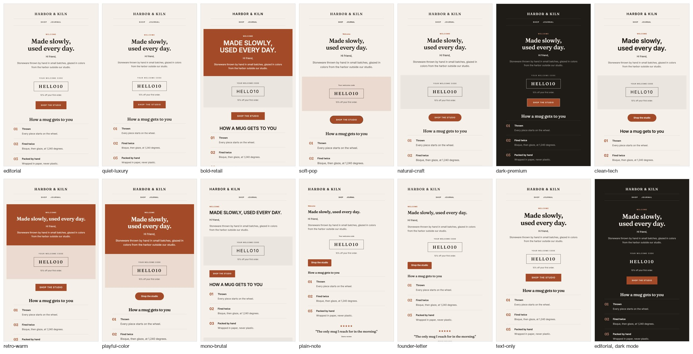

# Margarita

**Finished, send-ready marketing emails for any brand, from a link, a folder of photos and a palette.**

Margarita is an agent skill. Give your AI agent a brand URL, an asset folder and the brand colors,
and it delivers emails you can import into Klaviyo and send:

- Subject lines A and B, plus preview text
- Copy that sounds like the brand
- Client-safe HTML with the correct Klaviyo tags
- An import zip with the images
- Notes on every brand detail it had to infer

It runs in **Claude Code**, **Claude.ai** and **Google Antigravity**, and in any agent that reads
`SKILL.md` skills.



*One spec rendered in the 13 built-in styles, plus dark mode. The brand (Harbor & Kiln) is a demo
and doesn't exist.*

Prefer reading in a browser? The same instructions are on the website, in
[English](https://margaritacreative.com/guides/margarita-email-designer-docs) and
[Spanish](https://margaritacreative.com/es/guides/margarita-email-designer-docs).

---

## Contents

- [What you get](#what-you-get)
- [Install](#install)
- [Use it](#use-it)
- [How it works](#how-it-works)
- [The laws](#the-laws)
- [Styles, blocks, niches, occasions and popups](#styles-blocks-niches-occasions-and-popups)
- [Scripts (command line)](#scripts-command-line)
- [The spec file](#the-spec-file)
- [Output folder](#output-folder)
- [Importing into Klaviyo](#importing-into-klaviyo)
- [Testing](#testing)
- [Repository layout](#repository-layout)
- [FAQ](#faq)
- [Contributing](#contributing)
- [License](#license)

---

## What you get

For every email:

| File | What it is |
|---|---|
| `email.html` | The template to import into Klaviyo. Table layout, inline styles, Outlook (VML) button, dark-mode CSS, 620px mobile breakpoint, under 102 KB |
| `preview.html` | The same email with sample values in place of Klaviyo tags, for review only |
| `email.md` | Subjects A and B with the A/B variable, preview text, the copy by block, alt text and the source of every fact |
| `klaviyo-import.zip` | `email.html` plus its images, ready for Klaviyo's template import |
| `render-*.png` | Screenshots at 680px, 375px and 320px, with images off and in dark mode |

For the whole run:

- `notes.md`: the brand profile, inferred elements, assumptions, compliance flags, check results and
  a Klaviyo import checklist.
- `gallery.html`: every email at desktop and phone width, plus alternate styles and popup mockups.
- `popups/<slug>/`: a mockup and a step-by-step Klaviyo build sheet for each sign-up form.

## Install

Margarita is a plain folder: `SKILL.md` plus `references/`, `data/`, `assets/` and `scripts/`.
To install it, put the folder where your agent looks for skills.

### Requirements

- **Python 3.9 or newer.** `build.py`, `preflight.py`, `gallery.py` and `popup.py` use only the
  standard library.
- **Optional, for the render check:** Playwright for Python:
  `pip install playwright && playwright install chromium`. Without the bundled browser,
  `render.py` falls back to an installed Google Chrome.
- **Optional, for reading the brand site:** the [Firecrawl CLI](https://www.firecrawl.dev/).
  Without it, the agent uses its own web fetch or browser tool.
- **A Klaviyo account,** to send. Building and previewing emails works without one.

### Claude Code

```bash
# for all your projects
git clone https://github.com/yenderfonseca/margarita ~/.claude/skills/margarita

# or for one project only
git clone https://github.com/yenderfonseca/margarita .claude/skills/margarita
```

Start a new session. The skill loads by itself when your request fits its description, or you can
invoke it with `/margarita`.

### Claude.ai and the Claude desktop app

1. In **Settings > Capabilities**, turn on code execution (**Code execution and file creation**,
   or **Create and edit files** in the newer layout).
2. Get the ready-to-upload zip from the
   [Margarita Email Designer page](https://margaritacreative.com/resources/margarita-email-designer).
   Or zip this folder yourself: the zip must contain the `margarita/` folder with `SKILL.md` inside it.
3. Open **Customize > Skills**, click **+**, choose **Create skill**, then **Upload a skill**, and
   select the zip.

The build and lint scripts run in Claude's code sandbox. That sandbox may not include Playwright.
If the render check can't run, Margarita says so in `notes.md`, and you review `preview.html` in
your browser instead.

### Google Antigravity (IDE, App and CLI)

```bash
# for all your workspaces
git clone https://github.com/yenderfonseca/margarita ~/.gemini/config/skills/margarita

# or for one workspace only
git clone https://github.com/yenderfonseca/margarita .agents/skills/margarita
```

Older Antigravity IDE installs also read `~/.gemini/antigravity/skills/`. Antigravity picks up a
skill from its description, or you can name it in your prompt (in the App, type `/margarita`).
In the CLI, run `/skills reload` or start a new conversation after installing. In the IDE, the
skill appears under **Customizations** in the agent side panel.

### Several agents on one machine

Clone the repository once and link it into each agent's skills folder, so every agent runs the same
copy:

```bash
git clone https://github.com/yenderfonseca/margarita ~/code/margarita
ln -s ~/code/margarita ~/.claude/skills/margarita
ln -s ~/code/margarita ~/.gemini/config/skills/margarita
```

Update every agent at once with `git -C ~/code/margarita pull`.

## Use it

Ask in plain language. Some examples:

```text
Make a welcome series for https://example-brand.com. Photos are in ~/Desktop/brand-photos,
colors #1F1B16, #F5F1EA and #A34A28.

Launch email for our new hoodie: https://example-brand.com/products/hoodie, assets in ./assets.

Show me email styles for my candle shop, https://example-candles.com.

Black Friday campaign for this store, 20% off with code FRIDAY20, ends Sunday at midnight.
```

| Input | Needed? | If you leave it out |
|---|---|---|
| Brand link | A link or an asset folder | It works from the assets and brief, and marks every voice and product cue as inferred |
| Asset folder | No | It uses the site's own images. With no images at all, it builds text-led emails |
| Palette (hex) | Recommended | It takes the colors the site uses and logs them as inferred. It never invents colors |
| Brief, campaign type, audience, style, offer, banned words, output folder | No | It decides from the brand and the evidence, and notes each decision |

It stops to ask only when it has no link, no assets and no brief that names the brand. Otherwise
it delivers, then lists what you should check.

## How it works

The agent follows nine steps. `SKILL.md` holds the full instructions.

1. **Read the request:** link, asset folder, palette, brief and output folder.
2. **Intake:**
   - Read the site and save each page as evidence in `.source/`.
   - Inventory the assets (size and aspect ratio).
   - Map the palette to roles (canvas, ink, accent, text on accent), with a 4.5:1 contrast check.
   - Print a one-line status:
     `MARGARITA_PREFLIGHT: link=ok via firecrawl assets=15 files, 15 usable images palette=4 colors niche=Streetwear style=editorial library_mcp=absent`
3. **Decide:**
   - The niche (56 niches) and the occasion (calendar, product or relationship moment, or a lifecycle flow).
   - The style (13), the number of emails and the audience.
   - A starter spec comes from `build.py --scaffold`.
4. **Optional reference lookup:** if a Margarita library MCP server is connected, the agent pulls
   2 or 3 reference emails for layout cues. It never copies them.
5. **Write:** subjects A and B, preview text, the copy for each block, alt text and the CTA, each
   fact with its source.
6. **Build:** the agent writes everything into one `spec.json`. `build.py` renders the emails,
   copies the images, writes the import zip and runs preflight. Any preflight FAIL blocks delivery.
7. **Check:** `render.py` takes screenshots and measures each email:
   - Overflow, orphan words and broken images.
   - Button height.
   - Text that dark mode makes unreadable.
   - Console errors.

   Then the agent reviews the screenshots itself.
8. **Popups:** when asked, or when the occasion calls for one, `popup.py` writes mockups and
   Klaviyo build sheets.
9. **Package and report:** one line per email, the inferred elements to verify, compliance flags
   and the assumptions you can change.

## The laws

These rules are enforced by the build, the linter or the fact log. They don't depend on taste.

1. **Facts come from sources.** Products, prices, offers, codes, deadlines, reviews, stats and
   policies come from the link, the assets or the brief, word for word. If a fact is missing, its
   line or block is dropped, never made up.
2. **The palette is law.** Every color in the HTML is a supplied color, or a mix of supplied colors
   that is logged. Palette roles that fail 4.5:1 contrast stop the build.
3. **One email, one idea, one primary CTA,** with 3 to 6 body blocks.
4. **Klaviyo-correct:**
   - Only the URL forms of the legal tags go inside `href`.
   - The footer carries `{{ organization.full_address }}`.
   - Every `first_name` has a default.
   - Tags are balanced, and there is no merge syntax from other platforms.
5. **Client-safe and mobile-first:**
   - Table layout, inline styles and a bulletproof Outlook button.
   - A 620px breakpoint and 48px tap targets.
   - No SVG, scripts, forms or absolute positioning.
6. **Readable with images off:** live-text headlines and offers, styled alt text, and a background
   color on every image cell.
7. **House style:**
   - No em or en dashes, straight quotes only, no stacked `!!`.
   - No orphan words.
   - 28 to 32px of space above the CTA, and no cramped stacks.
8. **Sounds like the brand,** matched to voice samples from the site.
9. **Niche compliance holds,** for example for alcohol, supplements, CBD, finance, kids and eco
   claims (`data/niches.csv`, `compliance` column).

## Styles, blocks, niches, occasions and popups

### 13 styles (`data/styles.json`)

A style sets shape, type scale, rhythm, alignment and which blocks it hides. It never sets colors:
those always come from the brand palette.

| Style | Canvas | Best for |
|---|---|---|
| `editorial` | light | Fashion and apparel, home and living, beauty |
| `quiet-luxury` | light | Beauty, fashion, jewelry, fragrance |
| `bold-retail` | light | Sports and outdoor, fashion, food and beverage |
| `soft-pop` | light | Beauty, lifestyle, pet supplies |
| `natural-craft` | light | Food and beverage, wellness, home |
| `dark-premium` | dark | Jewelry, spirits, tech, fragrance |
| `clean-tech` | light | Tech and gadgets, wellness, software and B2B |
| `retro-warm` | light | Food and beverage, lifestyle, heritage brands |
| `playful-color` | light | Pet supplies, kids, snacks, lifestyle |
| `mono-brutal` | light | Streetwear, design-led brands, tech |
| `plain-note` | light | Welcome, founder notes, winback, cart reminders |
| `founder-letter` | light | Welcome story, brand story, winback |
| `text-only` | light | Announcements, policy or shipping updates, sale reminders |

### 31 blocks (`assets/blocks.html`)

| Group | Blocks |
|---|---|
| Top | `announcement`, `header` (centered, split or inverse) |
| Heroes | `hero_image`, `split_hero`, `hero_text`, `overlay_hero`, `image_band` |
| Story | `story`, `letter`, `quote`, `steps`, `media_rows`, `mosaic` |
| Selling | `cta`, `offer_code`, `products`, `spotlight`, `category_tiles`, `comparison`, `link_list` |
| Proof | `reviews`, `stats_row`, `press_strip`, `trust_row`, `feature_grid`, `ingredients`, `faq` |
| Utility | `disclaimer`, `cart_items` (Klaviyo checkout loop), `social`, `footer` (simple, rich or inverse) |

`python3 scripts/build.py --list` prints every block with its required fields.
[`references/spec.md`](references/spec.md) documents every field.

### 56 niches in 10 groups (`data/niches.csv`)

The groups are beauty, fashion, food, home, lifestyle, outdoor, pets, services, tech and wellness.
Each niche row carries:

- Matching keywords.
- Evidence from the Margarita library on which opener works there.
- Its best styles and its playbook.
- The compliance notes that niche requires.

`data/presets.json` holds 10 ready presets (audio, candles, coffee, jewelry, outdoor, pet, skincare,
spirits, streetwear and supplements). Each preset sets a style, an alternate style, fonts and an
approach to the palette.

### Occasions and flows (`data/occasions.json`)

| Kind | Occasions |
|---|---|
| Calendar | BFCM, holiday gift guide, last shipping day, New Year, Valentine's Day, Mother's Day, Father's Day, summer sale, brand anniversary |
| Product | Launch, back in stock, VIP early access, bestsellers |
| Relationship | Birthday, review request, referral |
| Flows | Welcome, abandoned checkout, browse abandonment, post-purchase, winback |

Each occasion has a block skeleton, the facts it needs, an angle, timing, sensitivity notes and a
matching popup.

### 8 sign-up form presets (`data/popups.json`)

Welcome offer, newsletter without a discount, exit intent, email then SMS, birthday capture, launch
or restock waitlist, holiday early access, and preference quiz. For each form you get a mockup and
a build sheet with the exact Klaviyo form-editor settings: timing, frequency, targeting, steps,
copy and colors. [`references/popups.md`](references/popups.md) has the rules.

## Scripts (command line)

All scripts live in `scripts/`. Each one prints its usage with `--help`.

```bash
S=path/to/margarita/scripts

# Build every email in a spec, then preflight each one
python3 $S/build.py spec.json --out out/brand
# Also render each email in other styles, for comparison (written to _styles/)
python3 $S/build.py spec.json --out out/brand --styles all
python3 $S/build.py spec.json --out out/brand --styles editorial,dark-premium
# List styles and blocks
python3 $S/build.py --list
# Print a starter spec for a preset or niche and an occasion
python3 $S/build.py --scaffold streetwear welcome

# Lint one email
python3 $S/preflight.py --html email.html --subject "Subject A" --subject "Subject B" \
  --preheader "Preview text" --palette "#1F1B16,#F5F1EA,#A34A28" --banned "word,phrase"
# Check the contrast between two colors
python3 $S/preflight.py contrast "#1F1B16" "#F5F1EA"

# Screenshots and measured checks
python3 $S/render.py out/brand/01-welcome/email.html
# One page showing every email and popup
python3 $S/gallery.py out/brand
# Popup mockups and Klaviyo build sheets
python3 $S/popup.py spec.json --out out/brand
```

| Script | Exit code |
|---|---|
| `build.py` | 0 when every email passes, 1 when preflight fails, 2 on a build error |
| `preflight.py` | 1 on any FAIL |
| `render.py` | 1 on horizontal overflow, orphan words, broken images or a primary button under 44px |
| `popup.py` | 1 when a check fails |

### What preflight checks

**FAIL:**
- A missing unsubscribe, preferences or web-view tag, or a non-URL tag form inside `href`.
- No organization address in the footer.
- A bare `first_name`, or unbalanced Klaviyo tags.
- Placeholder text, unfilled tokens, `href="#"` or an empty `src`.
- An email over 200 KB.
- Banned phrases.
- Em or en dashes, or curly quotes.
- A subject over 60 characters or preview text over 100.
- An image without alt text, or markup that isn't email-safe.
- Colors outside the palette.
- Zero primary CTAs, or more than one.

**WARN:**
- A subject over 50 characters.
- HTML over 102 KB.
- Spam-trigger words.
- External links without UTM.
- Local images still to upload.
- No MSO conditionals or no dark-mode CSS.

## The spec file

Every run is described by one `spec.json`: the brand (name, link, logo, fonts, palette, language),
then the emails, each a list of blocks, then optionally the popups. The build reads only this file,
so the emails can always be rebuilt from it. Fix the spec and rebuild; never edit `email.html` by
hand.

```json
{
  "style": "editorial",
  "utm_prefix": "brand",
  "assets_dir": "assets",
  "brand": {
    "name": "Harbor & Kiln",
    "home_url": "https://brand.example/",
    "heading_stack": "'Fraunces', Georgia, serif",
    "body_stack": "'Inter', Helvetica, Arial, sans-serif",
    "palette": {"canvas": "#F5F1EA", "ink": "#1F1B16", "accent": "#A34A28"}
  },
  "emails": [
    {
      "slug": "01-welcome",
      "subject": ["Subject A", "Subject B"],
      "preheader": "Preview text",
      "blocks": [
        {"type": "header"},
        {"type": "hero_text", "headline": "Made slowly, used every day."},
        {"type": "cta", "label": "Shop the studio", "url": "https://brand.example/shop"},
        {"type": "footer", "signup_reason": "You joined the list."}
      ],
      "sources": [{"claim": "...", "source": "https://brand.example/about"}]
    }
  ]
}
```

To try it, run `docs/demo.spec.json`, the complete demo behind the screenshot above:
`python3 scripts/build.py docs/demo.spec.json --out /tmp/margarita-demo`.
`assets/example.spec.json` uses every block.

Supported languages: `brand.lang` sets `<html lang>` and the fixed footer words. English, Spanish,
Portuguese, French, German and Italian are built in; for any other language, add a `brand.words`
object.

## Output folder

```
<out>/<brand-slug>/
  .source/          pages read during intake (the evidence for the fact log)
  spec.json         the single source for every email below
  notes.md          brand profile, inferred elements, assumptions, compliance flags, checks, import checklist
  gallery.html      every email at desktop and phone width, plus popup mockups
  _styles/          the same emails in alternate styles (when --styles is used)
  popups/<slug>/    mockup.html and build-sheet.md for each sign-up form
  01-<theme>/
    email.html      the Klaviyo-ready template (import this)
    preview.html    review copy with sample values (never import it)
    email.md        subjects A/B, preview text, copy by block, fact sources
    images/         local images used
    klaviyo-import.zip
  02-<theme>/ ...
```

`<out>` is the folder you name. If you don't name one, it's `./margarita-out`.

## Importing into Klaviyo

1. **Templates:** create a template, choose **Import**, and upload `klaviyo-import.zip`. If every
   image is already hosted, you can paste `email.html` into a code template instead.
2. **Organization:** set the organization name and address in Klaviyo. The footer reads both.
3. **Coupons:** create every coupon the emails reference, for example
   ``.
4. **Flows:** use the timings and filters listed in `notes.md`.
5. **Sign-up forms:** follow `popups/<slug>/build-sheet.md` in the form editor.
6. **Test:** send a test of each email to a real inbox, including Gmail and Outlook, in light and
   dark mode.

[`references/klaviyo.md`](references/klaviyo.md) lists the verified tags, flow event variables,
UTM rules and the full send checklist.

## Testing

```bash
python3 scripts/preflight.py --self-test   # example.html passes, and 13 broken copies each fail
python3 scripts/build.py --self-test       # the example spec builds in all 13 styles with clean preflight
```

GitHub Actions runs both self-tests on every push and pull request
([`.github/workflows/self-test.yml`](.github/workflows/self-test.yml)).

## Repository layout

The repository root is the skill folder, so cloning it is the whole install.

| Path | What it holds |
|---|---|
| `SKILL.md` | The agent's instructions: inputs, laws, the nine-step workflow, output contract |
| `references/brand-intake.md` | Reading the link, assets and palette; palette roles; fonts; the `notes.md` template |
| `references/campaign-selection.md` | Campaign type and audience defaults, taxonomy, block order by theme with evidence, choosing a style, flows |
| `references/copy.md` | Voice matching, subject and preview rules, body and CTA rules, house style |
| `references/layout.md` | Taste, mobile, spacing, images off, client safety, dark mode, orphans, the render check |
| `references/klaviyo.md` | Verified legal and personalization tags, event variables, UTM, import zip, send checklist |
| `references/spec.md` | Every spec field and block |
| `references/popups.md` | Sign-up form rules and the popup spec |
| `data/` | Styles, niches, presets, occasions, popups, themes, rules, industry playbooks |
| `assets/` | The email shell, the 31-block library, the example spec and a built example |
| `scripts/` | `build.py`, `preflight.py`, `render.py`, `gallery.py`, `popup.py` |
| `docs/` | The demo spec and README images |

## FAQ

**Does it send emails?**
No. It builds templates, and you import and send them from Klaviyo.

**Does it work with an email platform other than Klaviyo?**
The HTML is standard, client-safe email HTML. The merge and legal tags use Klaviyo's syntax. For
another platform, replace those tags, then run your platform's own checks.

**Will it make up products, prices or reviews?**
No. Every claim in an email has a source, listed in `email.md`. A block whose facts are missing is
dropped, not filled in.

**What if my brand has no palette file?**
It takes the colors the site actually uses, checks their contrast and logs the palette as inferred.

**Can I pick the look?**
Yes. Ask to see options. It builds the first email in two or three styles, or all 13, and shows you
the gallery.

**Does it need the Margarita library MCP server?**
No. The reference lookup is optional and only gives layout cues. The evidence the skill relies on
is already in `data/` and `references/`.

## Contributing

Issues and pull requests are welcome. Before you open one:

1. Run both self-tests. They must pass.
2. Keep the scripts standard-library only. Playwright stays limited to `render.py`.
3. A new block goes in `assets/blocks.html`, with its fields documented in `references/spec.md`.
   Prove it with `build.py --self-test`.
4. Data changes (niches, styles, occasions) must keep the JSON and CSV files valid.

## License

[MIT](LICENSE)
